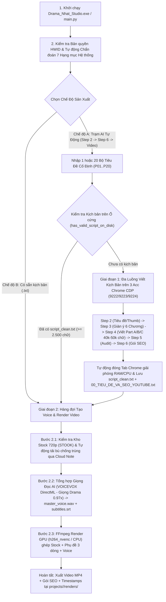

# QUY TRÌNH HOẠT ĐỘNG TOÀN DIỆN — DRAMA NHẬT STUDIO

Tài liệu này mô tả chi tiết kiến trúc và quy trình vận hành khép kín của ứng dụng **Drama Nhật Studio** (từ lúc khởi động, kiểm tra phần cứng/bản quyền, điều phối đa luồng viết kịch bản tiếng Nhật qua Chrome CDP, tổng hợp giọng đọc AI `VOICEVOX DirectML` với giọng chuẩn **`Drama (0.97x)`**, quản lý kho video nền `STOOK` 720p chống trùng lặp qua Cloud Note, cho đến khi xuất ra file Video `.mp4` hoàn chỉnh).

---

## 1. Sơ Đồ Tổng Quan Luồng Hoạt Động

---

## 2. Chi Tiết Từng Giai Đoạn Vận Hành

### Giai đoạn 0: Khởi Động, Bản Quyền & Tự Động Chẩn Đoán Hệ Thống
- **File thực thi**: [`Drama_Nhat_Studio.exe`](file:///d:/KEY%20NH%E1%BA%ACT%20DRAMA/TOOL_NHAT_DRAMA/Drama_Nhat_Studio.exe) $\rightarrow$ [`main.py`](file:///d:/KEY%20NH%E1%BA%ACT%20DRAMA/TOOL_NHAT_DRAMA/main.py) $\rightarrow$ [`backend/server.py`](file:///d:/KEY%20NH%E1%BA%ACT%20DRAMA/TOOL_NHAT_DRAMA/backend/server.py).
- **Cơ chế hoạt động**:
  1. **Kiểm tra Bản quyền (`LicenseManager`)**: Đối chiếu mã phần cứng máy (`HWID` dạng `DNS-XXXX-XXXX`) với file `license.json`.
  2. **Khởi tạo Server & Cửa sổ Desktop**: Bật máy chủ FastAPI + WebSocket thời gian thực tại `http://127.0.0.1:8899` và mở cửa sổ ứng dụng Desktop độc lập (`PyWebView` EdgeChromium).
  3. **Khôi phục & Đồng bộ Kho Dự Án ([`ADASScriptEngine._sync_projects_disk_state()`](file:///d:/KEY%20NH%E1%BA%ACT%20DRAMA/TOOL_NHAT_DRAMA/backend/adas_script_engine.py))**:
     - Tự động quét thư mục `projects/` để đồng bộ trạng thái các kịch bản đã viết xong (`SCRIPT_DONE`) và các dự án đã xuất video (`COMPLETED_VIDEO`).
     - Tự động chặn các mã đã xóa vĩnh viễn thông qua `deleted_ideas.json` (đảm bảo tiêu đề đã xóa không bao giờ tự load lại khi tắt đi bật lại, đồng thời bảo vệ 100% kịch bản đã tạo khi cập nhật ứng dụng).
  4. **Chẩn đoán Sức khỏe Hệ thống 7 Hạng mục ([`run_system_diagnostics()`](file:///d:/KEY%20NH%E1%BA%ACT%20DRAMA/TOOL_NHAT_DRAMA/backend/logger_service.py))**:
     - Kiểm tra tự động: (1) Card rời NVIDIA & PyTorch CUDA, (2) 16 thư viện Python bắt buộc, (3) FFmpeg & bộ mã hóa GPU `h264_nvenc`, (4) Bộ tạo giọng `VOICEVOX DirectML Engine` (Giọng `Drama` `0.97x`) & `OmniVoice`, (5) Kho video nền `STOOK` 720p, (6) Trạm 3 tài khoản Chrome ChatGPT, (7) Hàng đợi dự án chờ Render.

---

### Giai đoạn 1: Nhập Tiêu Đề & Điều Phối Đa Luồng Viết Kịch Bản (Step 2 $\rightarrow$ Step 6)
- **Module xử lý**: [`backend/adas_script_engine.py`](file:///d:/KEY%20NH%E1%BA%ACT%20DRAMA/TOOL_NHAT_DRAMA/backend/adas_script_engine.py) và [`backend/chatgpt_web_client.py`](file:///d:/KEY%20NH%E1%BA%ACT%20DRAMA/TOOL_NHAT_DRAMA/backend/chatgpt_web_client.py).

#### Bước 1.1: Quản lý 3 Tài khoản Chrome ChatGPT Web độc lập
- Hệ thống hỗ trợ 3 trình duyệt Chrome độc lập qua giao thức CDP (Chrome DevTools Protocol):
  - **Acc #1**: Cổng `9222` (`BROWSER_PROFILE`)
  - **Acc #2**: Cổng `9223` (`BROWSER_PROFILE_2`)
  - **Acc #3**: Cổng `9224` (`BROWSER_PROFILE_3`)
- Đường dẫn Profile được đăng ký bền vững tại `%LOCALAPPDATA%\Drama_Nhat_Studio\chrome_profiles_registry.json` giúp **không bao giờ bị văng tài khoản ChatGPT khi cập nhật tool**.
- Hỗ trợ nút **Ẩn/Hiện cửa sổ Chrome** (đưa cửa sổ về tọa độ `-3200, -3200` để chạy ngầm hoàn toàn không làm phiền màn hình).

#### Bước 1.2: Nhập & Bóc tách Bộ Tiêu Đề (Đơn lẻ hoặc Số Lượng Lớn `P01..P20`)
- Người dùng dán 1 hoặc nhiều bộ tiêu đề cố định (`P01 — ...`, `VI:`, `Keyword:`, `Evidence:`, `Reveal:`, `Capacity:`) vào ô nhập liệu và bấm **`💾 Lưu Vào Kho`** (hoặc **`🚀 Lưu & Chạy Ngay`**).
- Bộ phân tích [`split_raw_text_into_idea_blocks()`](file:///d:/KEY%20NH%E1%BA%ACT%20DRAMA/TOOL_NHAT_DRAMA/backend/adas_script_engine.py) tự động nhận diện số lượng bộ tiêu đề, bóc tách 23 trường dữ liệu và tạo sẵn câu lệnh `step2_prompt_ready.txt` cho từng mã.

#### Bước 1.3: Chạy Đa Luồng Kịch Bản (Phase 1 — Tập trung viết xong toàn bộ Kịch bản trước)
Khi bấm **`▶️ Chạy Đa Luồng (Kịch Bản → Voice)`**:
1. **Chốt chặn chống viết lại kịch bản**: Hệ thống kiểm tra hàm [`has_valid_script_on_disk()`](file:///d:/KEY%20NH%E1%BA%ACT%20DRAMA/TOOL_NHAT_DRAMA/backend/adas_script_engine.py). Nếu dự án đã có `script_clean.txt` (hoặc đủ `part_a.txt` + `part_b.txt` + `part_c.txt` đạt $\ge 2.500$ chữ thuần), hệ thống **tuyệt đối không mở Chrome viết lại** mà chuyển thẳng sang Giai đoạn 2 (Render Video).
2. **Cấp phát Tab độc lập đa luồng**:
   - Với các mã chưa có kịch bản, hệ thống chia đều (`Round-Robin`) lên các tài khoản Chrome đang mở (tối đa 3 luồng đồng thời/tài khoản).
   - Cơ chế khóa `_ACC_TAB_LOCKS` và `_PORT_INJECT_LOCKS` đảm bảo khi chạy 3 luồng sẽ mở đúng **3 Tab Chrome độc lập**, bơm prompt chính xác không tranh chấp Focus.
3. **Quy trình 5 Bước tự động trên ChatGPT Web cho mỗi dự án**:
   - **STEP 2 (`02_idea_title_thumbnail`)**: Phân tích ý tưởng, tạo 5 tiêu đề Nhật chuẩn CTR và chốt `LOCKED_TITLE` + Concept Thumbnail $\rightarrow$ lưu `step2_title_thumbnail.txt`.
   - **STEP 3 (`03_story_architecture`)**: Lập giàn ý chi tiết 6 Chương (6 Chapters), sổ cái nhân vật, vật chứng pháp lý/gia đình và nhịp cảm xúc $\rightarrow$ lưu `step3_architecture.txt`.
   - **STEP 4 (`04_script_writer`)**: Viết kịch bản tự sự tiếng Nhật dài (mục tiêu `40.000 – 50.000` ký tự thuần) chia làm 3 phần liên tiếp:
     - **Part A (Chương 1 & 2)** $\rightarrow$ `part_a.txt`
     - **Part B (Chương 3 & 4)** $\rightarrow$ `part_b.txt`
     - **Part C (Chương 5 & 6)** $\rightarrow$ `part_c.txt`
     - Nếu phần nào chưa đủ độ dài chuẩn, Agent tự động gửi lệnh viết nối tiếp (`Continue`) cho đến khi đủ chuẩn, sau đó làm sạch toàn bộ ký tự thừa và ghép thành `script_clean.txt`.
   - **STEP 5 (`05_script_auditor_100`)**: Kiểm định chất lượng kịch bản $\rightarrow$ lưu `step5_audit_report.txt`.
   - **STEP 6 (`06_seo_publish_pack`)**: Tạo gói SEO YouTube hoàn chỉnh (Tiêu đề, Mô tả, Tags, Hashtags, Prompt tạo ảnh Thumbnail) $\rightarrow$ lưu `00_TIEU_DE_VA_SEO_YOUTUBE.txt` (kèm cơ chế dự phòng `_build_fallback_seo_pack` tự động đóng gói SEO nếu mạng chập chờn để không bao giờ kẹt tiến trình).
4. **Dọn Tab tự động**: Ngay khi viết xong toàn bộ các mã trong Giai đoạn 1, hệ thống tự động đóng các Tab Chrome đã hoàn thành để chuyển 100% tài nguyên máy sang Giai đoạn 2.

---

### Giai đoạn 2: Tổng Hợp Giọng Đọc AI (`Drama 0.97x`) & Kết Xuất Video MP4
- **Module xử lý**: [`backend/pipeline.py`](file:///d:/KEY%20NH%E1%BA%ACT%20DRAMA/TOOL_NHAT_DRAMA/backend/pipeline.py), [`backend/voicevox_service.py`](file:///d:/KEY%20NH%E1%BA%ACT%20DRAMA/TOOL_NHAT_DRAMA/backend/voicevox_service.py), [`backend/stock_manager.py`](file:///d:/KEY%20NH%E1%BA%ACT%20DRAMA/TOOL_NHAT_DRAMA/backend/stock_manager.py), [`backend/video_service.py`](file:///d:/KEY%20NH%E1%BA%ACT%20DRAMA/TOOL_NHAT_DRAMA/backend/video_service.py).

#### Bước 2.1: Quản lý & Tự động tải bù Video Nền 720p (`STOOK`)
1. Hệ thống kiểm tra thời lượng video nền khả dụng trong thư mục `STOOK`.
2. Nếu người dùng bật tùy chọn tự động tải bù (hoặc bấm **`⚡ Tải Sẵn Đủ 10 Tiếng Stock Ngay`**):
   - Tự động đồng bộ danh sách ID video với **File Note Online chung (`https://rentry.co/nhat-drama-stock-9f8a7b6c`)** để đảm bảo các máy khác nhau không bao giờ tải trùng video của nhau.
   - Tự động tìm và tải video phong cảnh/thiên nhiên Nhật Bản ở độ phân giải **720p** (chỉ tải luồng hình, bỏ luồng tiếng gốc giúp tốc độ tải nhanh gấp 3–4 lần) và tự động cắt thành các đoạn `Part` 30 phút.

#### Bước 2.2: Tạo Giọng Đọc AI & Phụ Đề (`VOICEVOX DirectML Engine` — Giọng `Drama`)
1. **Khởi chạy Engine độc lập**:
   - Hệ thống tự động bật ngầm [`VOICEVOX_ENGINE/JAPANxxx/windows-directml/run.exe`](file:///d:/KEY%20NH%E1%BA%ACT%20DRAMA/TOOL_NHAT_DRAMA/VOICEVOX_ENGINE/JAPANxxx/windows-directml/run.exe) trên cổng cục bộ `50021`.
2. **Tùy chỉnh trong Vùng Chọn Voice**:
   - Mặc định sử dụng giọng **`Drama`** đã được tinh chỉnh khớp **99.8%** với mẫu giọng chuẩn của kênh:
     - Nhân vật gốc: `青山龍星 (ID = 13)`
     - Tốc độ đọc (`speedScale`): **`0.97x`**
     - Độ trầm (`pitchScale`): **`-0.02`** (`F0 median = 101.48 Hz`)
     - Ngữ điệu (`intonationScale`): **`0.95`**
     - Độ nghỉ ngắt câu (`pauseLengthScale`): **`1.12`**, Âm lượng (`volumeScale`): **`1.05`**
   - Người dùng có thể đổi sang 15 giọng khác hoặc kéo thanh trượt tinh chỉnh và bấm **`🔊 Nghe Thử Giọng Đang Chọn`** ngay trên giao diện.
3. **Tổng hợp từng câu & Tạo Phụ đề `.srt` chuẩn 3 dòng**:
   - Kịch bản `script_clean.txt` được tách thành từng câu thoại tiếng Nhật, tổng hợp ra các file `sentences/sentence_0001.wav`... và ghép nối thành `master_voice.wav`.
   - Tự động đo chính xác thời lượng từng câu để xuất file phụ đề `subtitles.srt` (tự động ngắt tối đa **3 dòng/khung hình**, tối đa 16–17 ký tự/dòng) và file mục lục `TIMESTAMPS.txt`.

#### Bước 2.3: Kết Xuất Video MP4 (`FFmpeg NVENC / CPU`)
1. Chọn các đoạn video nền từ kho `STOOK` sao cho đủ tổng thời lượng của `master_voice.wav` (đồng thời đánh dấu đoạn video nền đã sử dụng để các dự án tiếp theo không dùng trùng).
2. Chạy `FFmpeg` kết hợp:
   - Luồng hình ảnh nền 720p/1080p đã phủ lớp làm dịu sáng (`drawbox` / `eq`) để nổi bật chữ.
   - Đốt trực tiếp phụ đề tiếng Nhật cỡ chữ lớn dễ đọc (`FontSize = 135`) ở chính giữa màn hình.
   - Ghép luồng âm thanh `master_voice.wav`.
   - Tăng tốc phần cứng bằng bộ mã hóa GPU NVIDIA (`h264_nvenc`) hoặc tự động chuyển sang CPU (`libx264`) nếu máy không có card rời.
3. Xuất file thành phẩm tại: `projects/<MA_ID>/renders/<MA_ID>_master.mp4` và cập nhật trạng thái dự án thành **`✅ Đã xuất Video MP4`**.

---

## 3. Cấu Trúc Lưu Trữ Dữ Liệu Của Mỗi Dự Án (`projects/<MA_ID>/`)

Mỗi mã dự án (ví dụ `IDEA_001`, `IDEA_058`...) được lưu độc lập trong thư mục `projects/<MA_ID>/` bao gồm:
- `idea_info.json`: Thông tin cấu hình và trạng thái của dự án.
- `step2_title_thumbnail.txt`: 5 phương án tiêu đề, điểm số CTR và `LOCKED_TITLE`.
- `step3_architecture.txt`: Giàn ý chi tiết 6 Chương.
- `part_a.txt`, `part_b.txt`, `part_c.txt`: Bản thảo 3 phần kịch bản tiếng Nhật.
- `script_clean.txt`: Toàn bộ kịch bản tiếng Nhật hoàn chỉnh đã làm sạch để đọc Voice.
- `step5_audit_report.txt`: Báo cáo kiểm định chất lượng kịch bản.
- `00_TIEU_DE_VA_SEO_YOUTUBE.txt`: File tổng hợp Tiêu đề, Mô tả SEO, Tags, Hashtags và Prompt tạo Thumbnail để đăng YouTube.
- `assets/master_voice.wav`, `assets/subtitles.srt`, `assets/TIMESTAMPS.txt`: Giọng đọc hoàn chỉnh và phụ đề.
- `renders/<MA_ID>_master.mp4`: Video thành phẩm cuối cùng sẵn sàng tải lên YouTube.