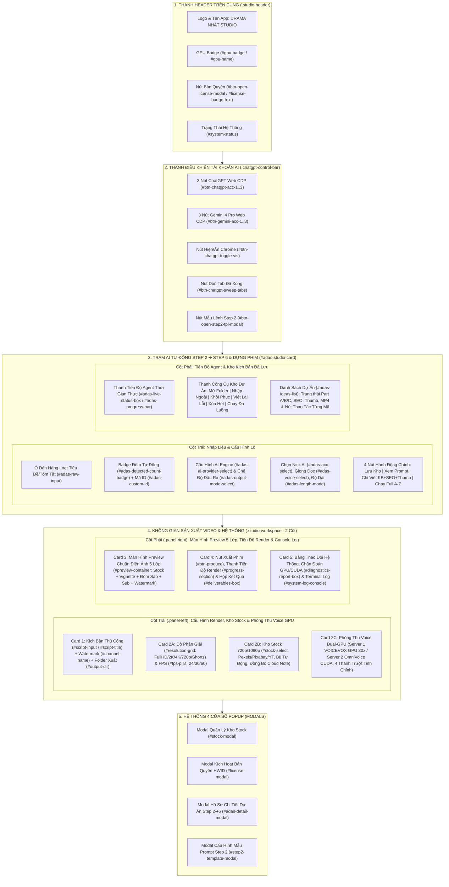
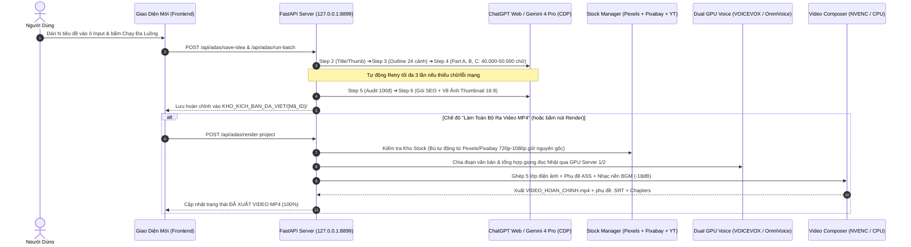

# 📐 SƠ ĐỒ KIẾN TRÚC & ĐẶC TẢ CHỨC NĂNG GIAO DIỆN — DRAMA NHẬT STUDIO V1.0

Tài liệu này tổng hợp toàn bộ **Sơ đồ bố cục (Layout)**, **Luồng hoạt động (Workflow)**, **Danh sách đầy đủ các chức năng**, **Mã DOM ID (`id="..."`)** trong [`frontend/index.html`](file:///d:/KEY%20NH%E1%BA%ACT%20DRAMA/TOOL_NHAT_DRAMA/frontend/index.html) / [`frontend/app.js`](file:///d:/KEY%20NH%E1%BA%ACT%20DRAMA/TOOL_NHAT_DRAMA/frontend/app.js) và **Danh sách API Backend** trong [`backend/server.py`](file:///d:/KEY%20NH%E1%BA%ACT%20DRAMA/TOOL_NHAT_DRAMA/backend/server.py) để phục vụ việc **thiết kế lại giao diện (UI/UX Redesign)** mà không làm đứt gãy bất kỳ tính năng nào.

---

## 1. SƠ ĐỒ TỔNG QUAN BỐ CỤC GIAO DIỆN (UI ARCHITECTURE DIAGRAM)

---

## 2. SƠ ĐỒ LUỒNG DỮ LIỆU & XỬ LÝ NGẦM (DATA & PIPELINE FLOW)

---

## 3. CHI TIẾT TỪNG KHU VỰC CHỨC NĂNG & BẢNG MÃ DOM ID (BẮT BUỘC GIỮ ĐÚNG `id` KHI THIẾT KẾ LẠI UI)

> [!IMPORTANT]
> Khi bạn thiết kế lại giao diện (`index.html` và `styles.css`), chỉ cần giữ nguyên các thuộc tính **`id="..."`** và **`data-...`** dưới đây thì toàn bộ logic trong [`frontend/app.js`](file:///d:/KEY%20NH%E1%BA%ACT%20DRAMA/TOOL_NHAT_DRAMA/frontend/app.js) sẽ hoạt động 100% ngay lập tức mà không cần viết lại logic kết nối Backend.

---

### KHU VỰC 1: THANH HEADER TRÊN CÙNG (`.studio-header`)
Hiển thị nhận diện thương hiệu, trạng thái phần cứng GPU, hạn bản quyền và trạng thái kết nối máy chủ.

| Thành phần | Mã DOM ID (`id`) | Chức năng chi tiết |
| :--- | :--- | :--- |
| Huy hiệu GPU | `#gpu-badge`, `#gpu-name` | Hiển thị tên card đồ họa (VD: `NVIDIA RTX 3060 NVENC`) hoặc chế độ CPU. |
| Nút Bản Quyền | `#btn-open-license-modal`, `#license-badge-text` | Hiển thị số ngày bản quyền còn lại; bấm vào mở Modal nhập Key / lấy Mã Máy HWID. |
| Trạng thái Hệ thống | `#system-status` | Báo trạng thái kết nối Backend (`Sẵn sàng sản xuất` / `Đang xử lý...`). |

---

### KHU VỰC 2: THANH ĐIỀU KHIỂN TÀI KHOẢN AI (`.chatgpt-control-bar`)
Quản lý trình duyệt Chrome ẩn danh độc lập (qua cổng Debug CDP `9222, 9223, 9224`) cho 3 tài khoản ChatGPT và 3 tài khoản Gemini 4 Pro.

| Thành phần | Mã DOM ID (`id`) | Chức năng chi tiết |
| :--- | :--- | :--- |
| 3 Nút Nick ChatGPT | `#btn-chatgpt-acc-1`, `#btn-chatgpt-acc-2`, `#btn-chatgpt-acc-3` | Mở Chrome riêng cho từng Nick ChatGPT để đăng nhập 1 lần (lưu Cookie vĩnh viễn). Có chấm trạng thái `.acc-dot`. |
| 3 Nút Nick Gemini | `#btn-gemini-acc-1`, `#btn-gemini-acc-2`, `#btn-gemini-acc-3` | Mở Chrome riêng cho từng Nick Gemini 4 Pro & Nano Banana để viết kịch bản và vẽ Thumbnail. |
| Nút Ẩn/Hiện Chrome | `#btn-chatgpt-toggle-vis` | Đưa các cửa sổ Chrome AI lên màn hình để quan sát hoặc thu nhỏ xuống thanh tác vụ. |
| Nút Dọn Tab | `#btn-chatgpt-sweep-tabs` | Đóng toàn bộ các tab AI đã chạy xong để giải phóng RAM cho máy. |
| Nút Mẫu Prompt Step 2 | `#btn-open-step2-tpl-modal` | Mở cửa sổ chỉnh sửa khung câu lệnh Prompt gốc cho Step 2. |

---

### KHU VỰC 3: TRẠM AI TỰ ĐỘNG STEP 2 ➔ STEP 6 & DỰNG PHIM (`#adas-studio-card`)
Trạm trung tâm điều khiển quy trình sản xuất công nghiệp từ ý tưởng thô ra Kịch bản 40.000–50.000 ký tự, SEO, Thumbnail và Video MP4.

#### 3.1. Cột Trái — Nhập Liệu & Cấu Hình Chạy Lô
| Thành phần | Mã DOM ID (`id`) | Chức năng chi tiết |
| :--- | :--- | :--- |
| Ô nhập kịch bản thô | `#adas-raw-input` | Hỗ trợ dán 1 hoặc N kịch bản cùng lúc (tự động tách theo dòng `===` hoặc số thứ tự). |
| Badge đếm số lượng | `#adas-detected-count-badge` | Tự động đếm và báo số lượng kịch bản phát hiện được trong ô nhập. |
| Nút Dán Mẫu Thử | `#btn-adas-fill-sample` | Điền nhanh mẫu tiêu đề/tóm tắt chuẩn để test quy trình. |
| Ô Mã Tiền Tố Dự Án | `#adas-custom-id` | Đặt mã định danh dự án (VD: `290326` -> tự đánh số `290326_01`, `290326_02`...). |
| Chọn AI Engine | `#adas-ai-provider-select` | 3 chế độ: `chatgpt_web` (ChatGPT Web), `gemini_4_pro` (Gemini 4 Pro + Nano Banana), `hybrid_gemini_chatgpt` (Gemini viết KB + ChatGPT vẽ Thumb). |
| Chọn Chế Độ Đầu Ra | `#adas-output-mode-select` | `full_video` (Chạy A-Z ra Video MP4) hoặc `script_seo_thumb_only` (Chỉ viết Kịch bản + SEO + Vẽ Thumbnail). |
| Chọn Nick AI | `#adas-acc-select` | `0` (Xoay vòng đa luồng cả 3 Nick) hoặc chỉ định Nick 1 / 2 / 3. |
| Chọn Giọng Đọc Lô | `#adas-voice-select` | Chọn giọng đọc áp dụng cho lô dự án (`auto_best` hoặc giọng cụ thể). |
| Chọn Độ Dài Kịch Bản | `#adas-length-mode` | `13334` (Siêu Dài 40.000–50.000 chữ = 3 Part A/B/C) hoặc `5000` (Bản Nhanh 15.000 chữ). |
| 4 Nút Thao Tác Chính | `#btn-adas-save-idea` `#btn-adas-preview-step2` `#btn-adas-save-and-script-only` `#btn-adas-save-and-run` | 1. **Lưu Vào Kho Dự Án** 2. **Xem Trước Lệnh Step 2** 3. **Lưu & Chỉ Viết KB + SEO + Thumb** 4. **Lưu & Chạy Tự Động Step 2 ➔ Video** |

#### 3.2. Cột Phải — Tiến Độ Agent & Kho Kịch Bản Đã Lưu (`KHO_KICH_BAN_DA_VIET`)
| Thành phần | Mã DOM ID (`id`) | Chức năng chi tiết |
| :--- | :--- | :--- |
| Hộp Tiến Độ Agent | `#adas-live-status-box`, `#adas-current-step-text`, `#adas-progress-pct`, `#adas-progress-bar`, `#adas-status-msg`, `#btn-adas-stop` | Hiển thị bước AI đang chạy (Step 2/3/4/5/6/Render), phần trăm hoàn thành, thông báo chi tiết và nút **Dừng Khẩn Cấp**. |
| Đếm Dự Án Trong Kho | `#adas-ideas-count` | Hiển thị tổng số dự án hiện có trong kho. |
| Thanh Công Cụ Kho (8 Nút) | `#btn-adas-open-projects-dir` `#btn-adas-import-external` `#btn-adas-restore-scripts` `#btn-adas-retry-errors` `#btn-adas-delete-all` `#btn-adas-script-only-all` `#btn-adas-render-ready` `#btn-adas-run-all` | • **📂 Mở Folder Kịch Bản**: Mở thư mục `KHO_KICH_BAN_DA_VIET` • **📥 Nhập Từ Máy Khác**: Nhập kịch bản từ máy khác về render • **🔄 Quét & Khôi Phục**: Phục hồi dự án từ ổ cứng • **🔁 Viết Lại Mã Lỗi / Thiếu**: Tự động lọc các mã lỗi/thiếu chữ để viết bù (kèm auto-retry 3 lần) • **🗑️ Xóa Tất Cả**: Xóa sạch danh sách • **📝 Chỉ Viết KB + SEO + Thumb (Tất Cả)** • **🎬 Render Tất Cả Đã Xong**: Dựng phim hàng loạt cho các mã đã có kịch bản • **▶️ Chạy Đa Luồng**: Chạy toàn bộ danh sách trên 3 luồng Chrome |
| Danh Sách Dự Án | `#adas-ideas-list` | Render động từng thẻ dự án: hiển thị Mã ID, Tiêu đề, số ký tự đạt được, tiến độ từng phần (`Part A`, `Part B`, `Part C`, `SEO`, `Thumb`, `MP4`) và các nút trên từng dòng (**Chạy A-Z**, **Chỉ Viết KB**, **🔁 Viết Lại**, **🎬 Dựng Video**, **📄 Xem Hồ Sơ**, **📂 Mở Folder**, **🗑️ Xóa**). |

---

### KHU VỰC 4: CỘT TRÁI — CẤU HÌNH VIDEO, KHO STOCK & PHÒNG THU VOICE GPU (`.panel-left`)

#### 4.1. Card 1 — Kịch Bản Đơn & Đường Dẫn Đầu Ra
| Thành phần | Mã DOM ID (`id`) | Chức năng chi tiết |
| :--- | :--- | :--- |
| Kịch bản thủ công (Ẩn/Hiện) | `#script-title`, `#script-input`, `#char-count`, `#est-duration`, `#est-scenes`, `#btn-load-sample`, `#btn-clear-script` | Nhận dữ liệu khi đẩy 1 kịch bản từ Kho xuống hoặc nhập tay để dựng lẻ. |
| Watermark Bản Quyền | `#channel-name` | Nội dung chữ đóng dấu góc phải trên video (Mặc định: `"."`). |
| Thư Mục Lưu Video | `#output-dir`, `#btn-browse-output-dir` | Chọn đường dẫn xuất video thành phẩm (Mặc định: `OUTPUT_VIDEOS`). |

#### 4.2. Card 2A — Độ Phân Giải & Tốc Độ Khung Hình (FPS)
| Thành phần | Mã DOM ID (`id`) | Chức năng chi tiết |
| :--- | :--- | :--- |
| Lưới Độ Phân Giải | `#resolution-grid` (các nút `.res-card` có `data-res`) | Chọn `1920x1080` (Full HD), `2560x1440` (2K QHD), `3840x2160` (4K UHD), `1280x720` (HD Nhanh), `1080x1920` (Shorts 9:16). |
| Chọn FPS | `#fps-pills` (các nút `.pill` có `data-fps`) | Chọn `24 fps` (Mặc định chuẩn Cinema), `30 fps`, `60 fps`. |

#### 4.3. Card 2B — Quản Lý Kho Video Nền (Stock 720p & 1080p)
| Thành phần | Mã DOM ID (`id`) | Chức năng chi tiết |
| :--- | :--- | :--- |
| Chọn Video Stock | `#stock-select`, `#available-stock-count` | Chọn `Tự động ghép nối tiếp không trùng` hoặc chọn đích danh 1 cuộn Stock. |
| Nút Đổi Folder & Mở Kho | `#btn-browse-stock-dir`, `#btn-open-stock-modal`, `#current-stook-path` | Đổi thư mục lưu Stock hoặc mở Popup quản lý chi tiết từng cuộn video. |
| Mục Tiêu Giờ Dự Trữ & Bù Tự Động | `#target-stock-hours`, `#btn-auto-replenish-main` | Đặt số giờ Stock muốn duy trì (VD: `10h` hoặc `30h`) và bấm **⚡ Bù Đủ Ngay** (Tự động tải từ **Pexels API + Pixabay API chuẩn 720p/1080p giữ nguyên gốc** + YouTube Agent-Reach). |
| Tùy Chọn Tự Động Kho | `#auto-ensure-stock`, `#auto-delete-stock` | Checkbox tự động tải bù trước khi render và tự động xóa cuộn Stock đã dùng xong để nhẹ ổ cứng. |
| Đồng Bộ Note Online | `#cloud-note-link-main`, `#btn-sync-cloud-main` | Đồng bộ danh sách video đã dùng lên Rentry Cloud Note để chống trùng lặp giữa nhiều máy. |

#### 4.4. Card 2C — Phòng Thu Giọng Đọc AI & Chuyển Đổi 2 Server GPU
| Thành phần | Mã DOM ID (`id`) | Chức năng chi tiết |
| :--- | :--- | :--- |
| Huy Hiệu Engine & GPU | `#voice-engine-badge`, `#gpu-balancer-badge` | Hiển thị trạng thái GPU TTS hiện tại. |
| Nút Chuyển 2 Server GPU | `#btn-gpu-server-1` `#btn-gpu-server-2` `#gpu-server-mode-hint` | • **Server 1**: `VOICEVOX GPU 30x` (DirectML GPU Native — Tốc độ siêu thanh) • **Server 2**: `OmniVoice CUDA GPU` (PyTorch CUDA GPU — Giọng siêu thực) |
| Danh Sách Giọng Đọc | `#voice-preset-select`, `#voice-desc-hint` | Chọn `auto_best` hoặc các giọng Nam/Nữ Nhật Bản (Aoyama, Kurono, Shikoku Metan, Kyushu Sora...). |
| 4 Thanh Trượt Tinh Chỉnh | `#voice-speed-range` (`#lbl-voice-speed`) `#voice-pitch-range` (`#lbl-voice-pitch`) `#voice-intonation-range` (`#lbl-voice-intonation`) `#voice-pause-range` (`#lbl-voice-pause`) | Điều chỉnh trực tiếp: **Tốc độ đọc (Speed)**, **Độ trầm/ổng (Pitch)**, **Nhấn nhá cảm xúc (Intonation)**, **Ngắt nghỉ câu (Pause)**. |
| Nghe Thử & Khôi Phục | `#btn-preview-voice`, `#btn-reset-drama-voice`, `#voice-preview-player` | Tạo đoạn âm thanh mẫu phát trực tiếp trên giao diện và nút đặt lại thông số chuẩn Drama. |
| Âm Lượng Nhạc Nền | `#bgm-vol`, `#bgm-vol-label` | Thanh trượt chỉnh âm lượng nhạc nền BGM (Mặc định `-18 dB`). |

---

### KHU VỰC 5: CỘT PHẢI — MÀN HÌNH PREVIEW 5 LỚP, XUẤT PHIM & TERMINAL LOG (`.panel-right`)

#### 5.1. Card 3 — Màn Hình Xem Trước Bố Cục 5 Lớp Chuẩn Điện Ảnh (`#preview-container`)
Mô phỏng trực quan khung hình 16:9 với 5 lớp hiệu ứng (Nền Stock `.layer-stock-bg` + Vignette tối góc `.layer-vignette` + Bụi sao `.layer-particles` + Dải tối đáy `.layer-bottom-band` + Phụ đề vàng viền đen `#preview-sub-text` + Watermark `#preview-watermark-text`).

| Thành phần | Mã DOM ID (`id`) | Chức năng chi tiết |
| :--- | :--- | :--- |
| Khung Preview & Các Lớp | `#preview-container`, `#preview-watermark-text`, `#preview-sub-text` | Tự động cập nhật chữ Watermark và tỷ lệ khung hình khi người dùng thay đổi cấu hình. |
| Thông Số Kỹ Thuật | `#spec-res`, `#spec-fps` | Hiển thị nhanh độ phân giải và FPS đang chọn. |

#### 5.2. Card 4 — Điều Khiển Xuất Phim & Bàn Giao Sản Phẩm
| Thành phần | Mã DOM ID (`id`) | Chức năng chi tiết |
| :--- | :--- | :--- |
| Nút Xuất Phim | `#btn-produce` | Kích hoạt tiến trình dựng phim cho kịch bản đơn hiện tại. |
| Hộp Tiến Độ Render | `#progress-section`, `#progress-msg`, `#progress-pct`, `#progress-bar`, `#progress-stage-name`, `#progress-time` | Hiển thị tiến độ tạo giọng đọc, ghép cảnh FFmpeg và bộ đếm giây thời gian thực. |
| Hộp Kết Quả Bàn Giao | `#deliverables-box`, `#result-paths-info`, `#btn-watch-video`, `#btn-open-dir`, `#btn-copy-srt`, `#btn-copy-chapters` | Khi xuất xong: Xem ngay video, mở thư mục chứa file, copy phụ đề `.SRT` hoặc copy `YouTube Chapters`. |

#### 5.3. Card 5 — Bảng Theo Dõi Hệ Thống & Chẩn Đoán Lỗi GPU/CUDA
| Thành phần | Mã DOM ID (`id`) | Chức năng chi tiết |
| :--- | :--- | :--- |
| Thanh Công Cụ Hệ Thống | `#btn-run-diagnostics` `#btn-install-missing-libs` `#btn-open-logs-folder` `#btn-copy-logs` `#btn-clear-logs` | • **🩺 Kiểm Tra GPU & Thư Viện** • **📦 Tự Cài Thư Viện Thiếu** (Hiện khi phát hiện thiếu gói) • **📂 Mở Thư Mục Logs** • **📋 Copy Toàn Bộ Log** • **🗑️ Xóa Log** |
| Hộp Báo Cáo Chẩn Đoán | `#diagnostics-report-box`, `#diag-summary-badges`, `#diag-details-list` | Hiển thị kết quả kiểm tra Python, FFmpeg NVENC, VOICEVOX GPU, PyTorch CUDA, dung lượng ổ cứng. |
| Bộ Lọc & Màn Hình Log | `#log-filter-pills`, `#system-log-console`, `#log-status-dot`, `#log-line-count` | Luồng log thời gian thực (Realtime Polling), hỗ trợ lọc theo `Tất cả`, `Chỉ Lỗi`, `Cảnh Báo`, `GPU & Voice`, `AI & Dựng Phim`. |

---

### KHU VỰC 6: 4 CỬA SỔ POPUP (MODALS)

1. **Modal Quản Lý Kho Stock (`#stock-modal`)**:
   - Đổi thư mục kho (`#modal-stook-dir-input`, `#btn-modal-browse-stock-dir`, `#btn-apply-modal-stock-dir`).
   - Đồng bộ Note Online chống trùng (`#cloud-note-link-modal`, `#btn-sync-cloud-modal`, `#cloud-note-url-text`, `#cloud-note-count-modal`, `#cloud-sync-msg`).
   - Tải & bù tự động hoặc dán link YouTube (`#btn-auto-replenish-modal`, `#yt-url`, `#btn-yt-download`, `#yt-download-msg`).
   - Bảng danh sách file Stock (`#modal-total-stocks`, `#btn-cleanup-used-stocks`, `#btn-rescan-stocks`, `#stock-table-body`).
2. **Modal Bản Quyền Theo Mã Máy (`#license-modal`)**:
   - Hiển thị Hardware ID (`#license-hwid-text`, `#btn-copy-hwid`).
   - Thông tin gói cước (`#lic-modal-status`, `#lic-modal-plan`, `#lic-modal-expiry`).
   - Nhập Key kích hoạt (`#license-key-input`, `#btn-activate-license`, `#license-modal-msg`, `#btn-close-license-modal`).
3. **Modal Hồ Sơ Dự Án Chi Tiết Step 2 ➔ Step 6 (`#adas-detail-modal`)**:
   - Các tab chuyển đổi (`.adas-view-tab` với `data-tab="seo_pack" | "script_clean" | "step2_output" | "step3_output" | "step5_output" | "step2_prompt"`).
   - Khung xem văn bản (`#adas-detail-textarea`), nút Copy (`#btn-adas-copy-detail`), nút Đẩy sang bàn dựng video (`#btn-adas-push-to-single`), nút đóng (`#btn-close-adas-detail-modal`).
4. **Modal Cấu Hình Mẫu Prompt Step 2 (`#step2-template-modal`)**:
   - Khung sửa template (`#step2-template-textarea`), nút Lưu (`#btn-save-step2-tpl`), nút đóng (`#btn-close-step2-tpl-modal`).

---

## 4. DANH SÁCH ĐẦY ĐỦ 47 API ENDPOINTS (BACKEND FASTAPI)

Khi thiết kế giao diện mới, mọi thao tác đều gọi về các API sau trên `http://127.0.0.1:8899`:

### A. Nhóm Hệ Thống, GPU, Voice & Chẩn Đoán
- `GET /api/system-info`: Lấy thông tin GPU, kho Stock, danh sách giọng đọc, cấu hình máy.
- `GET /api/system/logs`: Lấy luồng log thời gian thực cho Terminal Log.
- `POST /api/system/clear-logs`: Xóa bộ nhớ đệm log.
- `GET /api/system/diagnostics`: Chẩn đoán toàn diện GPU, CUDA, VOICEVOX, FFmpeg, thư viện Python.
- `POST /api/system/install-missing`: Tự động cài đặt các thư viện còn thiếu.
- `POST /api/system/open-logs-folder`: Mở thư mục chứa file log trên Windows Explorer.
- `GET /api/voice/gpu-server-mode`: Lấy chế độ Server GPU Voice hiện tại (`server_1_voicevox_gpu` hoặc `server_2_omnivoice_cuda`).
- `POST /api/voice/gpu-server-mode`: Chuyển đổi tức thì giữa Server 1 và Server 2.
- `POST /api/voice-preview`: Tạo và trả về file âm thanh nghe thử giọng đọc.

### B. Nhóm Bản Quyền (License Gate)
- `GET /api/license/status`: Kiểm tra trạng thái bản quyền và lấy Mã Máy (`HWID`).
- `POST /api/license/activate`: Kích hoạt hoặc gia hạn bằng mã Key.

### C. Nhóm Quản Lý Trình Duyệt AI (ChatGPT Web & Gemini 4 Pro CDP)
- `GET /api/chatgpt/status`: Kiểm tra trạng thái 3 cổng Chrome ChatGPT (`9222, 9223, 9224`).
- `POST /api/chatgpt/open-login`: Mở cửa sổ Chrome cho Nick ChatGPT 1/2/3.
- `GET /api/gemini/status`: Kiểm tra trạng thái 3 cổng Chrome Gemini 4 Pro.
- `POST /api/gemini/open-login`: Mở cửa sổ Chrome cho Nick Gemini 1/2/3.
- `POST /api/chatgpt/toggle-visibility`: Ẩn hoặc hiện tất cả cửa sổ Chrome AI.
- `POST /api/chatgpt/sweep-tabs`: Dọn dẹp các tab đã hoàn thành.

### D. Nhóm Trạm Sản Xuất Tự Động Step 2 ➔ Step 6 & Kho Dự Án (`ADAS`)
- `GET /api/adas/step2-template` & `POST /api/adas/step2-template`: Đọc / Lưu mẫu lệnh Prompt Step 2.
- `POST /api/adas/preview-step2`: Xem trước câu lệnh Step 2 sau khi điền biến.
- `GET /api/adas/ideas`: Lấy danh sách toàn bộ dự án trong kho beserta trạng thái chi tiết.
- `POST /api/adas/save-idea`: Lưu 1 hoặc hàng loạt ý tưởng vào kho.
- `DELETE /api/adas/ideas/{project_id}` & `POST /api/adas/clear-all-ideas`: Xóa 1 hoặc xóa tất cả dự án.
- `POST /api/adas/run-project`: Chạy tự động 1 dự án.
- `POST /api/adas/run-batch`: Chạy đa luồng toàn bộ dự án trên 3 Chrome.
- `POST /api/adas/retry-failed`: Tự động lọc và viết lại toàn bộ các dự án bị lỗi hoặc thiếu ký tự.
- `POST /api/adas/render-project` & `POST /api/adas/render-all-ready`: Dựng video MP4 cho 1 hoặc tất cả dự án đã có kịch bản.
- `POST /api/adas/stop`: Dừng khẩn cấp tiến trình AI đang chạy.
- `GET /api/adas/status`: Lấy trạng thái tiến độ thời gian thực của Agent.
- `GET /api/adas/project-detail/{project_id}`: Xem chi tiết toàn bộ văn bản Kịch bản, SEO, Outline, Audit của dự án.
- `POST /api/adas/open-projects-dir`: Mở thư mục gốc `KHO_KICH_BAN_DA_VIET` hoặc thư mục của từng mã dự án.
- `POST /api/adas/restore-scripts`: Quét ổ cứng và khôi phục các dự án cũ vào danh sách.
- `POST /api/adas/import-external-scripts`: Mở hộp thoại chọn file/thư mục kịch bản từ máy khác để nhập vào kho.

### E. Nhóm Quản Lý Kho Stock Video (Pexels + Pixabay + YouTube + Cloud Note)
- `GET /api/stocks` & `POST /api/stocks/rescan`: Lấy danh sách và quét lại kho Stock.
- `POST /api/stocks/set-dir` & `POST /api/browse-stock-dir`: Đổi thư mục chứa Kho Stock.
- `POST /api/stocks/cleanup-used`: Xóa tất cả các cuộn Stock đã đánh dấu sử dụng.
- `DELETE /api/stocks/{filename}`: Xóa 1 file Stock cụ thể.
- `POST /api/stocks/download-yt`: Tải và cắt cuộn 30 phút từ link YouTube chỉ định.
- `POST /api/stocks/auto-replenish`: Tự động tìm và tải bù đủ số giờ Stock mục tiêu (Ưu tiên Pexels & Pixabay chuẩn 720p/1080p giữ nguyên gốc + YouTube Agent-Reach).
- `GET /api/stocks/cloud-note` & `POST /api/stocks/sync-cloud`: Xem và đồng bộ danh sách chống trùng lên Rentry Cloud Note.

### F. Nhóm Xuất Phim Đơn Lẻ
- `POST /api/browse-output-dir`: Chọn thư mục xuất video.
- `POST /api/produce`: Bắt đầu dựng phim từ kịch bản đơn.
- `GET /api/status/{job_id}`: Theo dõi tiến độ render của `job_id`.
- `POST /api/open-output`: Mở thư mục chứa video thành phẩm hoặc phát video.